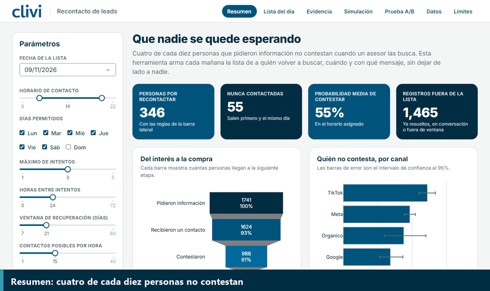

# Recontacto de leads: a quién volver a buscar, cuándo y con qué mensaje

Misión C: cuatro de cada diez personas que pidieron información no contestan cuando un asesor las busca. Esta herramienta genera cada mañana una lista de personas a las que conviene volver a escribir, con un horario sugerido, el motivo y un mensaje listo para enviar. Nadie se descarta por tener pocas probabilidades de contestar.



## Cómo responde a la misión

La misión: recuperar esas conversaciones. A quién volver a buscar, cuándo y con qué mensaje. Cuidar el trato: nadie nos debe una respuesta.

| La misión pide | Lo que hace la herramienta |
|---|---|
| Cuatro de cada diez no contestan | Medido en los datos: 40.3% de los 1,694 contactados |
| A quién volver a buscar | Lista priorizada: primero quien nunca fue contactado, después quien lleva más tiempo esperando |
| Cuándo | Un horario por persona, elegido con un modelo y repartido con un límite de contactos por hora, de 9:00 a 20:00 y de lunes a sábado |
| Con qué mensaje | Uno por intento (primer contacto, segundo y último), validado: no menciona la salud, no promete, no presiona y siempre trae cómo darse de baja |
| Nadie nos debe una respuesta | Máximo 3 intentos con 24 horas entre uno y otro, el último mensaje avisa que no se insistirá, y la lista se corta a los 21 días |
| Cuidar el trato | No se escribe a clientes, a quien dijo que no le interesa, a quien ya habla con un asesor ni a quien pidió no recibir mensajes; esas bajas se respetan siempre |
| Nadie queda fuera | La probabilidad de contestar solo elige el horario; quien no cabe un día pasa a una cola, no se descarta |

Además de la lista, la herramienta decide **qué mensaje** recibe cada persona según su situación (tres pasos, variantes A/B/C con estrategias distintas, todas validadas), **lee la respuesta** (baja, interés, cita, pregunta, malestar) y la lleva al asesor o a una acción, y mide qué variante recupera más conversaciones. Ver las pestañas Mensajes y Respuestas de la versión web.

Para producción: [`docs/ANALISIS_PENDIENTES.md`](docs/ANALISIS_PENDIENTES.md) (qué falta), [`docs/OPERACION.md`](docs/OPERACION.md), [`docs/SEGURIDAD_Y_PRIVACIDAD.md`](docs/SEGURIDAD_Y_PRIVACIDAD.md), [`docs/ARQUITECTURA.md`](docs/ARQUITECTURA.md) y [`CHANGELOG.md`](CHANGELOG.md).

Para la visibilidad en IA hay un plan de 90 días ([`docs/plan_visibilidad_ia.md`](docs/plan_visibilidad_ia.md)) y un panel para medirla (`python -m recontacto.visibilidad`).

Los datos de `data/` son ficticios (1,811 leads del 28-sep-2026 al 08-nov-2026). La documentación completa está en [`docs/README.md`](docs/README.md).

## Cómo correrlo

Lo más simple: doble clic en `bat\menu.bat`, que ofrece todo lo siguiente. O desde la línea de comandos:

```
pip install -r requirements.txt
set PYTHONPATH=src                (los .bat ya lo hacen solos)
python app/dash_app.py            abre http://127.0.0.1:8050
python -m recontacto.cli --hoy 2026-11-09
python -m pytest
python scripts/grabar_demo.py     regenera el GIF (con la app corriendo)
```

Para que los mensajes los redacte un LLM, define `ANTHROPIC_API_KEY` y agrega `--llm` en la línea de comandos. Sin llave, o si la respuesta no pasa la validación, se usan plantillas. La conexión con la API está escrita pero no se probó contra el servicio real; sí con un cliente simulado.

## Versión web: abre sin instalar nada

Enlace público: https://yoyo1505.github.io/recontacto-leads/ (código en https://github.com/Yoyo1505/recontacto-leads).

`web/entrega.html` es una sola página con las piezas de la entrega: la herramienta funcionando en el navegador (lista del día con reglas ajustables, evidencia, simulación, prueba A/B y carga de datos), el memo, la bitácora, el video y la prueba con dos personas. Se abre con doble clic (`batbrir_version_web.bat`) o se sube a cualquier hosting; el video `demo.mp4` va en la misma carpeta.

Reescribe la lógica en JavaScript y se comprueba contra la versión en Python: las mismas 346 recomendaciones, en el mismo orden y con los mismos horarios y mensajes (`node web/prueba_motor.js`). No reentrena el modelo ni lee Parquet, bases de datos o la nube: eso lo hace la versión en Python. Para regenerarla: `bat\construir_web.bat`.

## La aplicación (versión completa en Python)

Hecha en Dash y dividida en secciones independientes; cada archivo explica qué muestra y dónde cambiarlo.

| Sección | Qué responde |
|---|---|
| Resumen | Del interés a la compra y quién no contesta, por canal |
| Lista del día | A quién, cuándo y con qué mensaje; las reglas se cambian desde la barra lateral |
| Evidencia | Qué cambia la probabilidad de contestar y con cuánta confianza (intervalos, carta p, embudo de asesores) |
| Simulación | Cuánto mejoraría el recontacto, con la incertidumbre a la vista |
| Prueba A/B | Cuánta gente y cuánto tiempo hacen falta para comprobarlo |
| Datos | Subir un archivo o agregar personas, registrar bajas y volver a versiones anteriores |
| Límites | Lo que los datos no permiten afirmar |

Todas las gráficas son interactivas (Plotly): zoom, selección y descarga en PNG.

## Actualizar la información

Cuando llegan personas nuevas o cambian los resultados, no hace falta tocar código:

- Desde la sección **Datos** de la aplicación (arrastrar un archivo o llenar un formulario) o con los archivos de `bat/`: `actualizar_datos.bat` (CSV, JSON, Excel, Parquet, SQLite), `actualizar_desde_base.bat` (bases SQL) y `actualizar_desde_nube.bat` (web, S3, Google Cloud, Azure).
- Siempre se muestra primero un informe con lo válido, lo rechazado y qué haría la herramienta con cada persona nueva (`bat\simular_dos_personas.bat` lo enseña con un ejemplo). Nada se guarda hasta confirmar, no se borra a nadie, cada cambio guarda la versión anterior y se puede volver atrás.
- Las contraseñas de las conexiones van en variables de entorno, nunca en los archivos. Las conexiones reales a la nube y a PostgreSQL o MySQL no se probaron por falta de credenciales; los demás formatos sí.

Detalle en [`docs/README.md`](docs/README.md#3-actualizar-la-información).

## Qué hace, paso a paso

1. Limpia los datos: unifica dos formatos de fecha, marca 70 teléfonos repetidos, invalida edades imposibles y propaga a todos los registros de un teléfono si ya compró, rechazó o está en seguimiento.
2. Aplica las reglas de trato y deja fuera a quien no debe recibir mensajes (ver `docs/README.md`).
3. Estima con una regresión logística la probabilidad de que cada persona conteste en cada hora de los próximos días.
4. Reparte a las personas en horarios con un límite de contactos por hora. Los nunca contactados salen primero. Quien no cabe queda en cola y se reprograma.
5. Explica cada recomendación en una frase y propone un mensaje que pasa por un validador.

## Resultados

Lista del 9-nov-2026: 346 personas por recontactar, 55 nunca contactadas. Se excluyen 102 clientes, 359 rechazos, 534 en conversación, 400 fuera de ventana y 70 repetidos (un registro cuenta en el primer motivo que aplica).

Evaluación hacia adelante en el tiempo (entrenamiento antes del 25-oct, 1,066 contactos; prueba con los posteriores, 558):

| Modelo | AUC | Brier | Precisión en el 10% más alto |
|---|---|---|---|
| Tasa constante | 0.500 | 0.233 | 0.527 |
| Regresión logística | 0.603 (IC 95%: 0.549 a 0.647) | 0.227 | 0.836 |
| Árbol potenciado | 0.599 | 0.230 | 0.818 |

La señal es modesta. Se eligió la regresión logística porque rinde igual que el árbol y cada recomendación se puede explicar. AUC al entrenar con una sola familia de variables: solo canal 0.601, horario y canal 0.616, solo espera 0.575, solo horario 0.572, espera y horario 0.577, perfil 0.501, todo 0.603.

### Simulación y control estadístico

- Si recontactamos con los horarios del modelo en lugar de horarios sin optimizar, y suponemos que la mitad de la ventaja del horario es causal (alpha 0.5), contestan en promedio 5.7 personas más de 346, con un intervalo de 95% de −20 a +31. El modelo gana en el 65% de las corridas.
- Incluso suponiendo que toda la ventaja fuera causal (alpha 1), la mejora media es de unas 11 personas, con intervalo de −16 a +38. Con un solo día de lista no se distingue del azar. Las ventas extra esperadas son de menos de una por lista.
- Prueba A/B: detectar +3 puntos de respuesta con potencia de 80% requiere unas 4,100 personas por grupo, cerca de 200 días con el flujo actual (41 leads por día). Un efecto de 8 puntos requeriría unas 560 por grupo (27 días). El error tipo I simulado queda en torno al 5%.
- Carta p diaria: 1 de 42 días fuera de los límites de 3 sigmas.
- Gráfico de embudo por asesor: ninguno sale de los límites de 99.8%. Las diferencias entre asesores (35% a 41% de no contesta) caben en el azar.

## Lo que no se puede afirmar

- El canal explica casi toda la señal. El perfil de la persona (objetivo, edad, plan) no aporta nada.
- El horario y la espera aportan casi la misma señal. Los contactos de 13 a 18 h fueron casi todos rápidos (menos de 2 h tras el registro), y casi la mitad de los de 9 a 10 h ocurrieron entre 12 y 24 h después del registro. No se puede separar "mejor hora" de "contacto más rápido". Por eso la simulación recorre un supuesto, alpha, en lugar de afirmar un efecto.
- Solo hay un intento de contacto por lead. No hay datos de segundos intentos ni del mensaje usado, así que no se puede probar que un mensaje convenza más.
- El modelo subestima en el periodo de prueba: en los grupos de probabilidad baja, la predicha fue menor que la observada.
- El 84% de precisión en el 10% más alto se calcula con 55 contactos, así que es una cifra ruidosa.

La lista debe tratarse como una hipótesis para probar, no como una verdad demostrada.

## Plan de prueba

1. Asignar al azar la mitad de los leads a la lista del modelo y la otra mitad al proceso actual.
2. Medir el porcentaje que contesta en las siguientes 48 horas y el porcentaje que pide la baja.
3. Dentro del grupo del modelo, probar plantilla contra LLM.
4. Detener la prueba si suben las bajas o las quejas.
5. Para separar el efecto del horario del de la rapidez, variar el horario del primer contacto a leads equivalentes.
6. Tamaño: ver la sección Prueba A/B para el número de personas según el efecto que se quiera detectar.

## Estructura

```
src/recontacto/    lógica: datos, ingesta, variables, modelo, reglas, asignación, mensajes, simulación, control
app/               aplicación Dash, dividida en secciones (ver docs/README.md)
bat/               archivos .bat para todo (empieza por menu.bat)
scripts/           grabar_demo.py
web/               versión web (motor.js, app.js, plantilla) y su comprobación contra Python
tests/             168 pruebas automáticas
docs/              documentación, bitácora, investigación de Clivi, GIF y capturas
data/              datos ficticios
```
